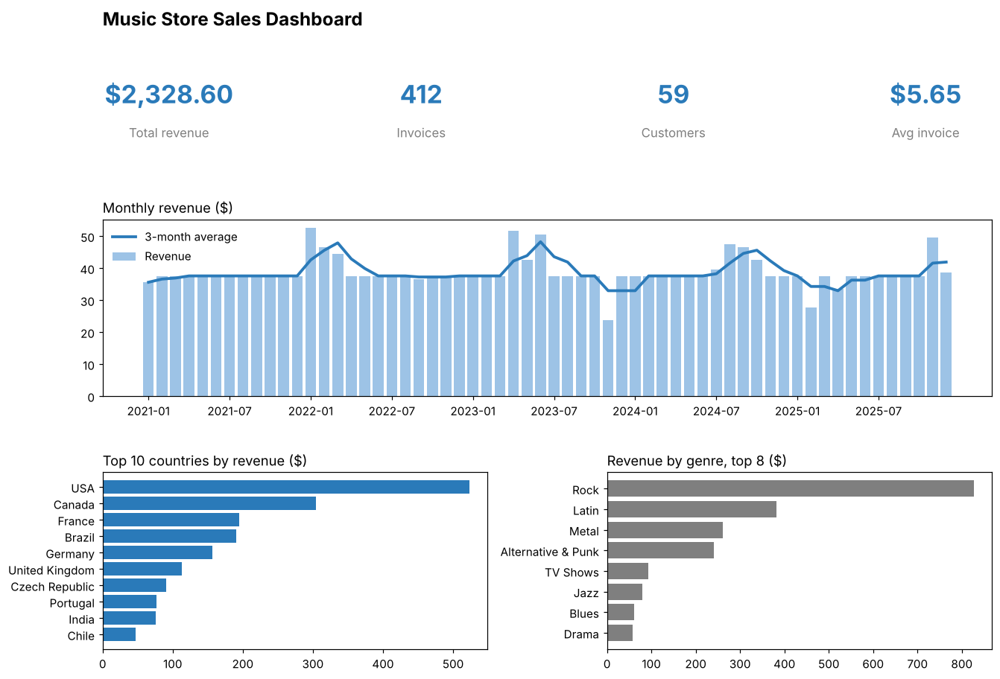

# Music Store Sales Analytics — SQL + Dashboard

Business analysis of a digital music store's sales database with **SQL** (joins, CTEs, window functions) and an **interactive dashboard** in Python/Plotly. The questions are the ones a sales or BI team would ask: where does revenue come from, how is it trending, which genres sell where, and which customers are most valuable or at risk of leaving.



## Key findings

- **$2,328.60** revenue from **412 invoices** and **59 customers** (2021–2025); the average invoice is **$5.65**.
- **USA (22.5%)** and **Canada (13.1%)** bring in over a third of revenue.
- **Rock** is 35.5% of revenue and the top genre in 22 of 24 countries; Latin is second at 16.4%.
- Revenue is flat year to year (about $450–$480), with short spikes rather than growth: a sign the store depends on repeat buying from a small base.
- **RFM segmentation:** 15 "Champions" (recent, high spend) bring in 26.7% of revenue, while 14 high-value customers who haven't bought recently ($578.68, 24.9% of revenue) are the clearest target for a win-back campaign.
- Sales rep **Jane Peacock** manages the most revenue ($833.04 across 21 customers).

## SQL queries

| File | Business question | SQL skills |
|---|---|---|
| `01_kpis.sql` | Headline numbers | aggregates, `COUNT(DISTINCT)`, subquery |
| `02_monthly_revenue.sql` | Monthly trend | CTE, `strftime`, `SUM() OVER`, `LAG`, rolling average |
| `03_revenue_by_country.sql` | Revenue by country and share | `JOIN`, `GROUP BY`, `SUM() OVER ()` |
| `04_top_genre_per_country.sql` | Best genre in each country | 5-table `JOIN`, `ROW_NUMBER() OVER (PARTITION BY)` |
| `05_genre_revenue.sql` | Revenue by genre | `JOIN`, percent of total |
| `06_sales_rep_performance.sql` | Rep performance | `JOIN`, `RANK()` |
| `07_customer_segments.sql` | RFM customer segments | chained CTEs, `julianday`, `NTILE`, `CASE` |
| `08_top_artists.sql` | Top artists | 4-table `JOIN`, `LIMIT` |

## How to run

```bash
pip install -r requirements.txt
python run_queries.py      # runs every query, saves CSVs in outputs/
python dashboard.py        # builds dashboard.html and images/dashboard.png
```

Open `dashboard.html` in a browser for the interactive version (hover for values). To rebuild it in Power BI, follow [POWER_BI_GUIDE.md](POWER_BI_GUIDE.md).

## Data

The [Chinook sample database](https://github.com/lerocha/chinook-database) (MIT licence): a widely used **fictional** digital music store with 11 related tables (customers, invoices, tracks, genres, employees). Because it is sample data, the findings show the analysis method rather than a real company's results.

```
Customer ─< Invoice ─< InvoiceLine >─ Track >─ Album >─ Artist
   │                                    │
Employee (support rep)                 Genre
```

## Repository structure

```
├── data/chinook.sqlite      the database (SQLite)
├── sql/                     8 queries, one business question each
├── run_queries.py           runs the queries and saves results
├── dashboard.py             builds the dashboard
├── dashboard.html           interactive dashboard
├── outputs/                 query results as CSV
├── images/dashboard.png
├── POWER_BI_GUIDE.md
└── requirements.txt
```

*Author: Mohammed Mudabbir Ahmed · B.Sc. Data Science, Memorial University of Newfoundland · [LinkedIn](https://www.linkedin.com/in/mmudabbirahmed)*
